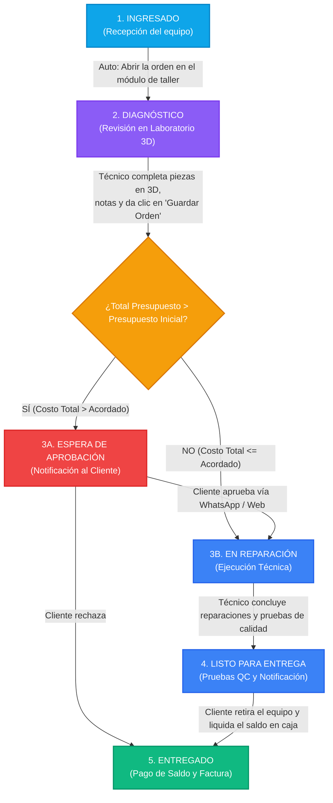

# Diagrama del Flujo de Estados de Orden de Servicio

Este documento describe la arquitectura y ciclo de vida de los estados en **EnTuCel**, detallando las transiciones automáticas, eventos del sistema y la bifurcación condicional basada en el presupuesto acordado.

---

## 🔄 Flujo Completo del Ciclo de Vida



---

## 📌 Explicación Detallada por Etapa

### 1. `ingresado` (Recepción inicial)
- **Acción**: La recepción o caja registra al cliente, la falla reportada y el **Presupuesto Máximo Inicial Acordado**.
- **Transición**: Tan pronto como el técnico ingresa a ver los detalles de la orden en el taller, el sistema promueve la orden automáticamente a **`diagnostico`**.

### 2. `diagnostico` (Inspección en laboratorio)
- **Acción**: El técnico examina el dispositivo, interactúa con el **Gemelo Digital 3D**, desglosa las piezas dañadas (pantalla, batería, etc.), asigna costos de repuesto e ingresa la mano de obra.
- **Borrador local**: Todo el diagnóstico se edita en memoria local (`draftTwin`) sin saturar la base de datos.
- **Evaluación al Guardar**: Al presionar *"Guardar Diagnóstico y Presupuesto"*, se calcula:
  $$\text{Total Presupuesto} = \sum (\text{Costo Repuestos}) + \text{Mano de Obra}$$

---

### 🔀 Bifurcación Condicional

```
                    ┌──────────────────────────────────────────────┐
                    │ ¿Total Presupuesto > Presupuesto Inicial?   │
                    └──────────────────────┬───────────────────────┘
                                           │
                    ┌──────────────────────┴──────────────────────┐
                    ▼                                             ▼
                 [ SÍ ]                                        [ NO ]
    ┌───────────────────────────────┐             ┌───────────────────────────────┐
    │     espera_aprobacion         │             │         reparacion            │
    ├───────────────────────────────┤             ├───────────────────────────────┤
    │ Requiere autorización manual  │             │ Pasa directo a reparación sin │
    │ del cliente por sobrecosto.   │             │ frenar el taller.             │
    └───────────────────────────────┘             └───────────────────────────────┘
```

#### Caso A: Total $\le$ Presupuesto Inicial Inicial
- El monto entra dentro del margen previamente autorizado por el cliente.
- El estado pasa directamente a **`reparacion`** (`En Reparación`) para agilizar el trabajo.

#### Caso B: Total $>$ Presupuesto Inicial Inicial
- El monto excede lo pactado previamente con el cliente (ejemplo: se descubrió un corto adicional en la tarjeta madre o falla en la batería).
- El estado cambia automáticamente a **`espera_aprobacion`** (`Espera Aprobación`).
- Se genera una alerta de sobrecosto y el sistema queda bloqueado para la reparación física hasta que el cliente autorice la diferencia.

---

### 3. `reparacion` (Mano de obra y sustitución)
- El técnico reemplaza los componentes físicos marcados en el Gemelo Digital 3D.
- Una vez concluidas las reparaciones y las pruebas de calidad (QC), el técnico marca la orden como **`listo`**.

---

### 4. `listo` (Listo para entrega)
- El equipo está completamente reparado y probado.
- El cliente recibe una notificación de que puede pasar a recoger su dispositivo.

---

### 5. `entregado` (Cierre y entrega)
- El cliente acude a la tienda, realiza el pago del saldo pendiente ($\text{Total} - \text{Abono}$) y firma digitalmente la recepción conforme del equipo.
- La orden se marca como **`entregado`** y finaliza su ciclo de vida.
