# Manual de Usuario Oficial - EnTuCel Repair Manager
### Sistema Integral de Gestión de Reparaciones, Control de Inventario, Caja y Rastreo Público

---

## Tabla de Contenidos
1. [Introducción y Visión General](#1-introducción-y-visión-general)
2. [Acceso al Sistema y Registro del Negocio](#2-acceso-al-sistema-y-registro-del-negocio)
3. [Roles y Modelo de Permisos Granulares](#3-roles-y-modelo-de-permisos-granulares)
4. [Cómo Crear y Gestionar Empleados](#4-cómo-crear-y-gestionar-empleados)
5. [Registro y CRM de Clientes](#5-registro-y-crm-de-clientes)
6. [Creación de Órdenes (Firma Opcional)](#6-creación-de-órdenes-de-servicio-firma-opcional)
7. [Modelo 3D Interactivo y Gemelo Digital](#7-modelo-3d-interactivo-y-gemelo-digital)
8. [Notificaciones Directas por WhatsApp](#8-notificaciones-directas-por-whatsapp)
9. [Impresión Doble: Ticket Cliente vs. Etiqueta Taller](#9-impresión-doble-ticket-cliente-vs-etiqueta-taller)
10. [Seguimiento Público para Clientes (Public Tracking)](#10-seguimiento-público-para-clientes)
11. [Módulo Financiero, Caja y Comisiones](#11-módulo-financiero-caja-y-comisiones)
12. [Configuración del Taller](#12-configuración-del-taller)

---

## 1. Introducción y Visión General

**EnTuCel - Repair Manager** es la plataforma web líder diseñada para la administración integral de talleres de servicio técnico de telefonía móvil y electrónica.

El sistema unifica el ciclo completo de reparación:
- **Recepción de equipos** e ingreso de fallas reportadas.
- **Firma digital opcional** y recepción de abonos.
- **Visor 3D interactivo (Gemelo Digital)** para diagnóstico visual por piezas.
- **Impresión Doble:** Ticket impreso para el cliente y etiqueta adhesiva con QR para pegar en el celular.
- **Notificaciones automáticas por WhatsApp**.
- **Seguimiento público en tiempo real para el cliente final**.
- **Gestión financiera de caja, utilidades y comisiones**.

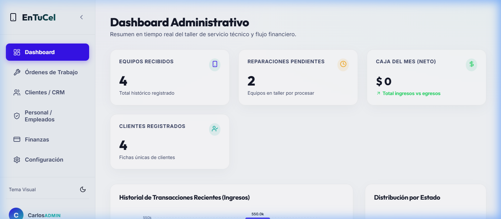

---

## 2. Acceso al Sistema y Registro del Negocio

Para ingresar a la plataforma, visite la pantalla de acceso web (ejemplo: `/login` o `https://entucelwv.web.app/login`).

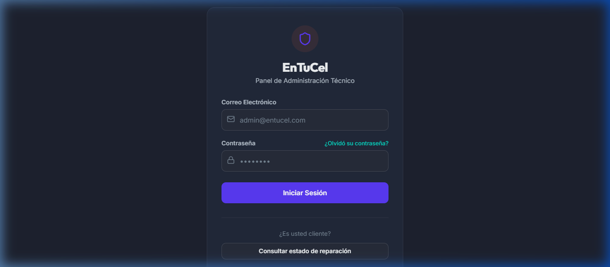

### 2.1 Acceso Rápido para la Etapa de Pruebas
Para explorar de inmediato todas las pantallas y evaluar las funciones del taller sin necesidad de registrar datos nuevos, utilice las siguientes cuentas de prueba pre-configuradas:

| Rol de Usuario | Correo Electrónico de Prueba | Contraseña | Acceso y Alcance |
| :--- | :--- | :--- | :--- |
| **Administrador** | `admin@entucel.com` | `admin123` | Control total del sistema, módulos, usuarios y configuración. |
| **Técnico** | `tecnico@entucel.com` | `tecnico123` | Diagnóstico 3D, actualización de estados de órdenes y repuestos. |
| **Recepción** | `recepcion@entucel.com` | `recepcion123` | Ingreso de clientes, creación de órdenes, abonos y tickets. |

### 2.2 Registro de la Cuenta Principal al Entregar el Taller
Cuando el sistema vaya a ponerse en marcha de forma definitiva para la operación real del taller:

1. Al ingresar por primera vez a un entorno nuevo sin usuarios registrados, la pantalla mostrará automáticamente el formulario **"Registro de Administrador Inicial"**.
2. El propietario o gerente del taller ingresa su **Nombre Completo**, su **Correo Electrónico Principal** y define su **Contraseña Segura**.
3. Al guardar, el sistema crea la cuenta administradora principal e ingresa directamente al panel de control.
4. A partir de este momento, el Administrador podrá crear las cuentas personales para su equipo de técnicos y recepcionistas desde el módulo **Personal / Empleados**.

> [!TIP]
> **Tema Visual (Modo Oscuro / Claro):** En el menú lateral izquierdo puede hacer clic sobre el botón de Sol/Luna para alternar entre el modo oscuro y el modo claro según su preferencia.

---

## 3. Roles y Modelo de Permisos Granulares

El sistema cuenta con un modelo de seguridad basado en roles y permisos individualizados:

| Rol | Permisos Predeterminados | Perfil Destinado |
| :--- | :--- | :--- |
| **Administrador (`admin`)** | Acceso total: Dashboard, Órdenes, Clientes, Personal, Finanzas, Permisos y Configuración. | Dueños y gerentes generales del taller. |
| **Técnico (`tecnico`)** | Diagnóstico técnico, uso de Visor 3D, actualización de estados y repuestos consumidos. | Técnicos de reparación y laboratorio. |
| **Recepcionista (`recepcion`)** | Ingreso de nuevas órdenes, recepción de abonos, registro de clientes y entrega de equipos. | Personal de atención al cliente en mostrador. |

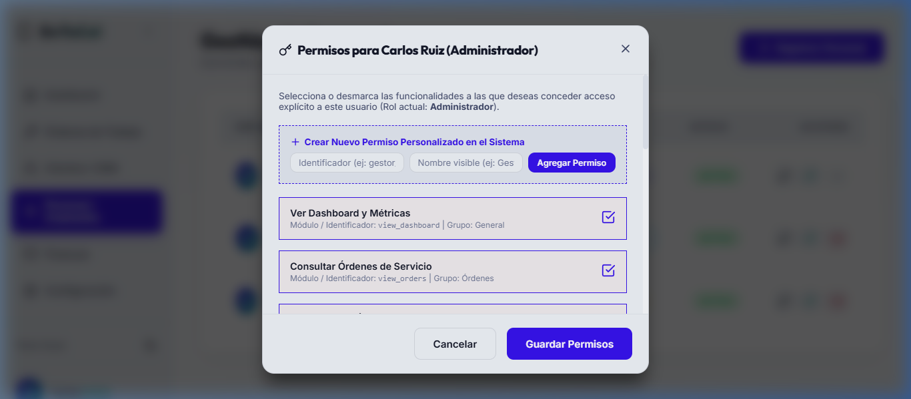

---

## 4. Cómo Crear y Gestionar Empleados

*(Disponible para Administradores)*

1. Ingrese a la sección **Personal / Empleados** (`/users`).
2. Presione el botón **+ Registrar Personal**.
3. Complete el Nombre Completo, Correo Electrónico, Teléfono Móvil y seleccione el Rol (`Administrador`, `Técnico` o `Recepción`).
4. Haga clic en **Guardar Empleado**.
5. Para ajustar o restringir accesos específicos de un empleado, presione el icono de **Escudo/Permisos** junto a su nombre.

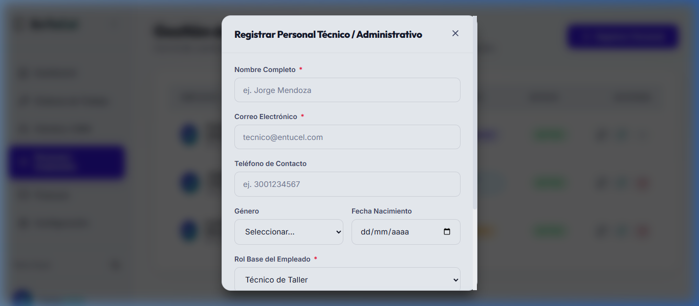

---

## 5. Registro y CRM de Clientes

### Método A: Registro Rápido al Crear una Orden
Al momento de registrar una orden de servicio en mostrador, haga clic en el botón **+ Registrar Nuevo Cliente** para ingresar el nombre y número móvil en segundos sin salir del formulario.

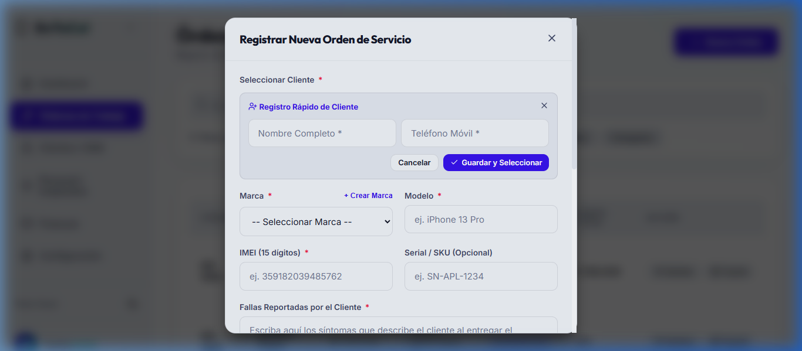

### Método B: Módulo de Clientes (CRM)
En la sección **Clientes / CRM** (`/clients`), registre clientes con información completa y consulte el historial acumulado de todos los celulares traídos a reparación.

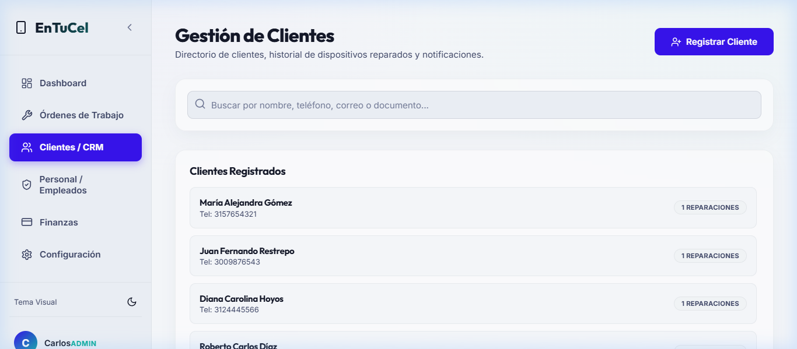

---

## 6. Creación de Órdenes de Servicio (Firma Opcional)

Al ingresar una nueva orden de servicio:
- **Campos Obligatorios (*):** Selección de Cliente, Marca del Celular, Modelo, IMEI (15 dígitos) y Falla Reportada.
- **Campos Opcionales:** Número de Serie, Diagnóstico Inicial, Abono Inicial y **Firma Digital**.

> [!NOTE]
> **Confirmación de Firma Táctil:** La firma digital del cliente **NO es obligatoria** para guardar la orden. Si el cliente no desea firmar en pantalla al ingresar el equipo, la orden se guarda sin inconvenientes y la firma se puede capturar al entregar el celular.

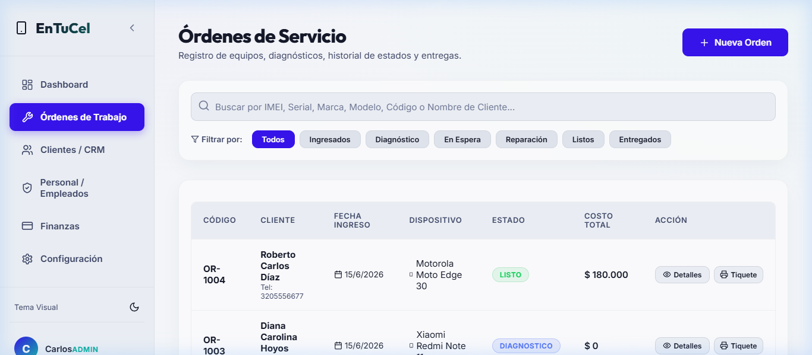

---

## 7. Modelo 3D Interactivo y Gemelo Digital

En la vista detallada de la orden (`/orders/OR-XXXX`), el técnico cuenta con un **Gemelo Digital 3D** en tiempo real del smartphone.

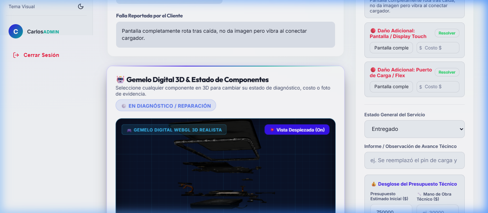

### Características del Visor 3D:
- **Vista Despiezada (Exploded View):** Separa en espacio 3D el cristal OLED, marco de aluminio, batería de litio, tarjeta madre PCB, cámaras y flex de carga.
- **Modo Rayos X (X-Ray):** Hace transparentes los paneles exteriores para ver el interior del celular.
- **Inspección Interactiva por Componente:** Al hacer clic sobre cualquier pieza 3D, se puede cambiar su estado operativo (`DAÑADO` en rojo, `EN REPARACIÓN` en amarillo o `VERIFICADO` en verde).

---

## 8. Notificaciones Directas por WhatsApp

El sistema se conecta de forma nativa con WhatsApp Web y WhatsApp Business:

1. Presione el botón **Notificar por WhatsApp** en la orden o ficha del cliente.
2. Se genera un mensaje automático con el saludo, número de orden, modelo del celular, estado actual y el **enlace directo de seguimiento público** (`/tracking?order=OR-XXXX`).
3. Se abre la ventana de chat oficial lista para enviar en un clic.

---

## 9. Impresión Doble: Ticket Cliente vs. Etiqueta Taller

El sistema ofrece 2 formatos de impresión de alta precisión para impresoras térmicas o estándar:

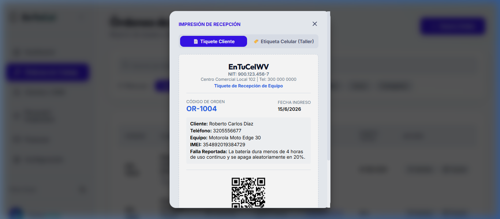

1. **📄 Tiquete Cliente:** Comprobante de recepción con datos del negocio (NIT, Dirección, Teléfono), resumen de la orden y **Código QR para Rastreo Público** (`/tracking?order=OR-XXXX`).
2. **🏷️ Etiqueta Celular (Taller):** Etiqueta adhesiva pequeña para pegar en la carcasa trasera del teléfono en reparación. Incluye el código de orden en grande, IMEI y **Código QR de acceso directo interno** para que los técnicos abran la orden en el sistema escaneándola con la cámara.

---

## 10. Seguimiento Público para Clientes

El cliente final consulta el avance escaneando el QR de su ticket o entrando a `/tracking`:

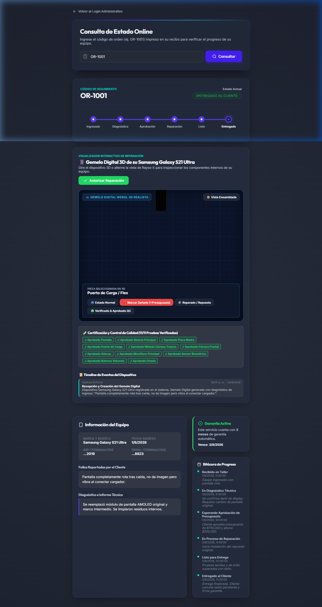

---

## 11. Módulo Financiero, Caja y Comisiones

Supervise ingresos por abonos, cobros de entrega, egresos por insumos y cálculo de comisiones técnicas.

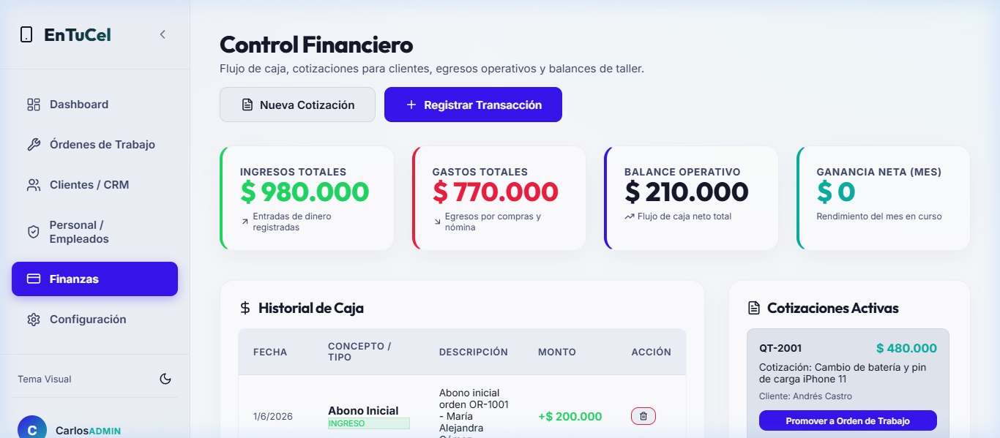

---

## 12. Configuración del Taller

Configure los datos del establecimiento que aparecen en los tickets y términos de garantía.

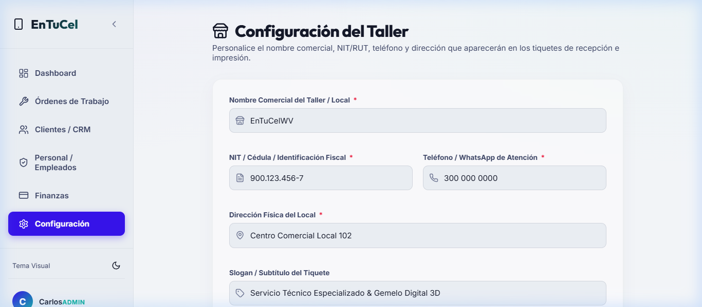

---

*Manual de Usuario EnTuCel Repair Manager v1.0.0*
